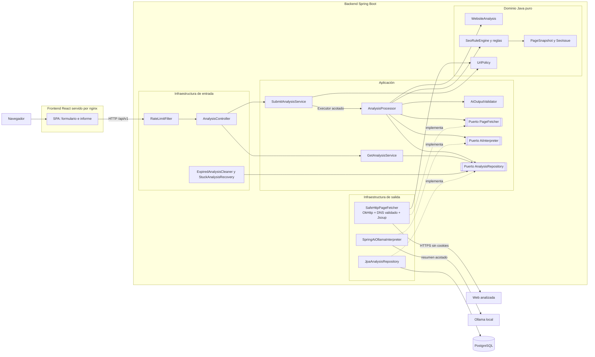
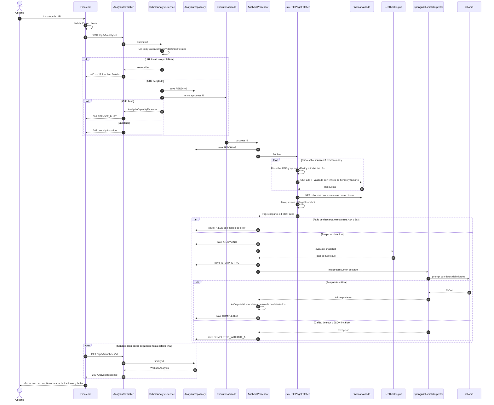

# Arquitectura de BrowseMe

Paquete raíz: `io.github.raulramalf.browseme`. Detalle de tipos en
[contratos.md](contratos.md) y de carpetas en [estructura.md](estructura.md).

## 1. Vista hexagonal

Las dependencias apuntan siempre hacia dentro: la infraestructura conoce la
aplicación y el dominio; el dominio no conoce a nadie. ArchUnit lo verifica.

Cosas que el diagrama deja claras:

- **El dominio no tiene flechas hacia fuera.** `UrlPolicy` es lógica pura que
  usan dos actores: el servicio de envío (respuesta rápida al `POST`) y el
  fetcher, que la aplica a cada IP resuelta en cada salto. Esa segunda
  aplicación es la validación que cuenta.
- **El HTML crudo no cruza el puerto.** `SafeHttpPageFetcher` descarga,
  parsea con Jsoup y devuelve solo un `PageSnapshot`.
- **La IA está al final y es prescindible.** Si Ollama falla, el análisis
  termina igual con los hechos de las reglas.
- En los perfiles `dev` y `test` se sustituyen adaptadores (`FakeAiInterpreter`,
  `InMemoryAnalysisRepository`) desde `UseCaseConfig`, sin tocar la aplicación.

## 2. Secuencia de un análisis

## 3. Explicación del flujo

1. **Envío.** El frontend valida la URL y hace `POST`. El backend aplica límite
   por IP, valida la sintaxis con `UrlPolicy` (incluidas IPs literales en
   formatos alternativos), guarda el análisis como `PENDING` y lo encola. La
   respuesta es inmediata: `202` con el `id`. Si la cola está llena, `503`.
2. **Descarga segura.** Un hilo del ejecutor acotado toma el trabajo. El
   fetcher resuelve DNS por su cuenta, rechaza el destino si **cualquiera** de
   las IPs está prohibida y conecta a la IP ya validada (sin segunda
   resolución, contra DNS rebinding). Sigue las redirecciones a mano y repite
   las comprobaciones en cada salto. Corta el cuerpo a 2 MB y el tiempo total a
   20 s. Lee `robots.txt` con las mismas protecciones.
3. **Hechos.** Jsoup convierte el HTML en un `PageSnapshot` sin HTML crudo. El
   motor de reglas, que es puro y determinista, produce los `SeoIssue` con su
   evidencia y limitación.
4. **Interpretación.** A Ollama solo le llega un resumen acotado, etiquetado
   como datos no confiables. La respuesta se valida contra el esquema y contra
   los `ruleId` realmente detectados. Si algo falla, el resultado se guarda
   como `COMPLETED_WITHOUT_AI`, que es un resultado válido, no un error.
5. **Consulta.** El frontend sondea `GET` hasta un estado final y pinta el
   informe, que separa «verificado por reglas» de «interpretación de IA».
6. **Mantenimiento.** Cada hora se borran los análisis caducados (7 días). Al
   arrancar, los que quedaron en un estado intermedio pasan a `FAILED` con
   `INTERRUPTED`.
